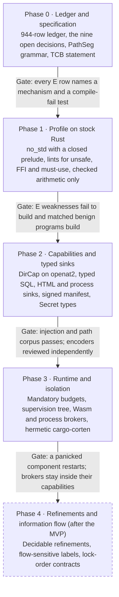

# Corten — Secure-by-Construction Rust Profile

As of 2026-10-26 · Martin Holovsky

**Corten is a hardened Rust profile that makes whole classes of security bugs impossible to write, and makes the rest mechanically checkable.**

## What Corten is

Corten is a security profile of Rust: same syntax, compiler and tooling, but with a locked-down standard library and stricter rules.

Its goal is to remove security bugs by construction instead of finding them later. Code can't touch files, the network or processes without being explicitly handed that permission. No string can become a SQL query, HTML or a shell command without going through a typed builder. Arithmetic is always checked, errors can't be silently ignored, and memory-unsafe or foreign code runs isolated, never in-process.

It's measured against all 944 weaknesses in MITRE's CWE catalogue. The target is to make roughly a fifth of them impossible to write and most of the rest mechanically checkable, while being honest about the small share no language can fix: business logic, intent and design.

**What it is not**

- **Not a new language.** It's Rust with a stricter profile.
- **Not "bulletproof".** It can enforce a wrong policy perfectly. Authorization rules, business logic and requirements are still your job.
- **Not finished.** Today it's a ratified design with no implementation, and every "impossible to write" claim is still to be proven by tests.

Corten is a ratified design, not a built or verified one: every guarantee below is a claim to be made true, and this document is the work plan for doing that.

## 1. Status and provenance

The design was produced on 25–26 October 2026 by a panel of five frontier models from five vendors. Each wrote a blind proposal, then debated for three rounds while seeing the others only as anonymous letters. They voted a drafter and ratified the joint specification.

| Member | Model | Role |
| --- | --- | --- |
| A | openai/gpt-5.6-sol | Drafter of the joint spec |
| B | google/gemini-3.1-pro-preview | Panelist |
| C | x-ai/grok-4.7 | Panelist |
| D | deepseek/deepseek-v4-pro-0813 | Panelist |
| F | qwen/qwen3.8-max-prime | Panelist |
| E | moonshotai/kimi-k3.1-pro | Dropped: every request timed out, no text |

**Ratification: 5 of 5 accepted with reservations; none accepted outright, none rejected.** Their required amendments are folded into section 5 and are part of this design, not optional polish.

**How to read the claims.**

- Sections 3, 4 and 7 restate the joint spec drafted by Member A, edited for structure.
- The panel named the design "Ferrum" (Latin for iron). It was renamed Corten on 2026-10-26: weathering steel, whose rust layer protects the metal, fits a profile that turns Rust's own features into the defence. See the README's "Why Corten" section.
- Every "E" (eliminated by construction) claim is the panel's assertion. None has been implemented or tested.
- The bucket counts were checked mechanically against the catalogue (944 of 944 ids present). The design mechanisms behind them were not verified.
- The drafter vote tied A 2 to F 2 and was broken by fixed panel order, not by judgement.
- The panel ran inside the author's private AethelGard project. The full debate transcript is not published here; this document and the ledger are the public record of its outcome.

## 2. Goal and classification model

The goal is to remove as many coding weaknesses as possible by construction, and to make the rest mechanically checkable, measured against all 944 non-deprecated weaknesses in MITRE CWE 4.20 (2026-04-30).

Every CWE gets exactly one bucket:

| Bucket | Meaning | Test it must pass |
| --- | --- | --- |
| **E** — eliminated by construction | A program with the weakness does not compile or cannot be expressed | Holds for every broker-free Corten program, with no annotation from the programmer |
| **C** — mechanically checkable | Types, effects, capabilities, contracts, proofs or mandatory runtime checks catch it | Depends on someone stating the policy or spec (which principal may call what, which data is secret) |
| **O** — out of reach | Design, requirements, intent or business-logic flaws | No language can decide it; name what covers it instead |
| **N** — not a coding weakness | Hardware design, physical, silicon or documentation-only | No code in any language could exhibit it |

**A mandatory runtime check counts as C, not E.** So bounds-checked memory safety (out-of-bounds read and write) is C. This definitional choice moved those ids out of E and is the panel's first recorded dissent.

**The E boundary is a broker-free Corten component.** The claims assume the compiler, the closed prelude, its encoders, the reference monitor and the brokers are correct. Bugs there, and in the manifest signer, are outside every E claim. Native code linked into the same address space is never inside the boundary.

**Undecidable properties are sidestepped, not solved.** Termination, semantic equivalence and general deadlock freedom are out of scope. Corten restricts what can be written, asks for annotations in decidable fragments, or inserts runtime checks.

## 3. Decision: a hardened Rust profile

Corten is a hardened Rust profile plus compiler extensions, not a new language. It keeps Rust syntax, ownership and borrowing, Cargo, LLVM targets, debuggers and IDEs, and replaces Rust's ambient standard library with a closed, capability-oriented prelude.

In the blind round, A, B and F chose a Rust profile, while C ("Hart") and D ("Aegis") chose a new language in the Rust lineage. By round 3 all five had moved to a Rust profile. The deciding argument was adoption: a language nobody can use mitigates nothing, and the properties needed (capabilities, context-typed sinks) can be delivered by a closed prelude rather than new syntax.

```rust
#![corten]
#![deny(unsafe_code)]
#![deny(unused_must_use)]
#![corten::no_ambient_authority]
```

**Corten is deliberately not source-compatible with ordinary `std` code** that relies on any of these:

- ambient filesystem, network, process, clock or environment access;
- raw string sinks for interpreters (SQL, HTML, shell);
- native in-process FFI or application `unsafe`;
- unrestricted build scripts.

**Prior art the design draws on:** Rust and Cyclone ownership, E and Joe-E object capabilities, Koka-style effect rows, Trusted Types and Yesod-style context-typed output, RE2 regular expressions, RLBox and Wasm isolation, and refinement systems restricted to decidable theories.

## 4. Language design

Fifteen mechanisms make up Corten. Each subsection states the rule, then the bucket it earns and what stays outside it.

### 4.1 Memory, initialization and representation

Corten keeps Rust's affine ownership and borrowing and removes every escape from it in application code:

- aliasing XOR mutable access, definite initialization, no null references;
- no raw pointers, `transmute`, unchecked layout casts, `mem::forget`, manual free or user-defined finalization;
- slices instead of pointer and length pairs;
- linear OS handles that cannot be used after transfer or release, and no cycles containing linear resources;
- no undefined behaviour in the profile (see amendment on implementation-defined behaviour in section 5).

Ownership puts invalid free, double free, use-after-free, dangling stack references and type confusion in **E**. Bounds checks are mandatory unless the compiler proves them redundant, so out-of-bounds weaknesses are **C**.

```rust
fn byte_at(xs: &[u8], i: usize) -> Result<u8, BoundsError> {
    xs.get(i).copied().ok_or(BoundsError)
}
```

Application-defined destructors are restricted; resource types use compiler-supplied linear finalizers. RAII does not prove a resource lived for the right semantic lifetime, so retention policy stays **C**.

### 4.2 Numeric semantics

All integer arithmetic is checked in every build profile. Overflow, underflow, invalid shifts, divide-by-zero and narrowing conversions return `Result` or trap at a component boundary.

```rust
let total: u32 = a.checked_add(b)?;
let count: u16 = u16::try_from(input)?;
let mode: Wrapping<u32> = Wrapping(x) + Wrapping(y);
```

`Wrapping<T>`, `Saturating<T>`, fixed-width bit vectors, endian wrappers and floating-point policies are distinct types, and there are no implicit numeric casts. Public functions with several same-typed parameters require argument labels: `copy_bytes(src: input, dst: output, count: n)?`.

Checked operations stop silent wraparound. They do not prove an off-by-one is correct or that a formula implements the requirement; that needs refinements, tests or review.

### 4.3 Effects and capabilities

No filesystem, network, process, environment, clock, randomness, privilege or credential authority is ambient. `main` receives unforgeable capability values from a signed deployment manifest; possession grants authority, strings and integers do not.

```text
fn load_config(root: DirCap, name: PathSeg)
    -> Result<Config, Error> / {fs, decode}
```

Effect rows are inferred. Standard effects: `fs`, `net`, `process`, `environment`, `clock`, `random`, `credential`, `database`, `log`, `dynamic_code`, `unsafe`, `ffi`, `raw_io`. Capabilities make every use of authority visible; deciding which principal should get which capability is policy and stays **C**.

### 4.4 Filesystem and path resolution

Applications cannot open a string pathname. They open a validated segment relative to a directory capability:

```rust
let segment = PathSeg::parse(upload_name)?;
let file = uploads.open(segment, OpenMode::CreateExclusive)?;
```

The reference monitor uses `openat2` with mandatory `RESOLVE_BENEATH`, `RESOLVE_NO_SYMLINKS` and `RESOLVE_NO_MAGICLINKS`, or refuses the operation on platforms without race-resistant resolution. Temporary files are created atomically with exclusive ownership. Executable search through `PATH` does not exist.

Escaping an already granted `DirCap` is inexpressible (**E**). Choosing the wrong root, pre-existing hard links and an over-broad directory grant stay **C**. D and F moved CWE-22 to C in ratification, and A and C made path E conditional on a published `PathSeg` grammar; see section 5.

### 4.5 Untrusted data, parsers and interpreter sinks

External data enters as `Untrusted<Bytes>` or `Untrusted<Text>`. Validation produces domain values, never a generic "sanitized string":

```rust
let email: EmailAddress = EmailAddress::parse(request.email)?;
let query: SqlQuery = sql! { SELECT name FROM users WHERE id = {id} };
let page: Html = html! { <p>{display_name}</p> };
let command: ProcessInvocation = process!(tar, ["-cf", archive, directory]);
let entry: LogRecord = log_record!("login", user = user_id);
```

There is no conversion from `String` to `SqlQuery`, `Html`, `HttpHeader`, `LogRecord`, `LdapFilter`, `XPathExpr`, `XQueryExpr`, `CsvCell`, `Template`, `Url`, `Argv` or `PathSeg` without parsing for that grammar. The closed prelude has none of these:

- shell-string execution, `eval`, dynamic source include, class-name reflection or dynamic variables;
- server-side include interpreters, DTDs or XML external entities;
- backtracking regular expressions (regex is RE2-style, linear time);
- polymorphic gadget deserialization;
- runtime-controlled format strings.

Injection into the standard interpreters owned by the prelude is **E**. Programmer-defined grammars and generic neutralization stay **C**. Deserialization is schema-directed and constructor-free, but schema choice, size limits, depth and versioning stay **C**.

### 4.6 HTTP and browser-facing APIs

Headers, cookies, URLs, redirects, HTML and WebSocket upgrades are separate types.

```rust
fn redirect(target: SameOriginUrl) -> NoReturn;
fn set_cookie<T>(cookie: SecureCookie<T>);
```

Cookie constructors set `Secure` and `HttpOnly` unconditionally and require an explicit `SameSite` policy; credential-bearing cookies cannot go through the generic header API. Origin, CORS, frame-ancestor, redirect-domain, CSRF and session-expiry decisions need policy and are **C**.

### 4.7 Errors and exceptional conditions

There are no exceptions, catch-all handlers or `finally`. Recoverable failures use linear, must-use `Result`; discarding one is a compile error and matching is exhaustive.

```rust
fn store(record: Record) -> Result<RecordId, StoreError>;
```

A panic terminates the component. It prevents continuing in corrupted state but is not correct error handling, and it turns memory corruption into denial of service (see supervision, section 5). Error types carry information-flow labels, so a secret-bearing error cannot reach a public response or log without explicit declassification.

### 4.8 Concurrency

Ownership prevents unsynchronized data races. Corten adds structured concurrency, bounded channels, affine lock guards, no mutable public statics, signals as typed events, cancellation-safe resource scopes, and a `blocking` effect that is ill-typed inside non-blocking event loops.

```rust
async fn handle(req: Request) -> Result<Response, Error> / {net, database} {
    // a call with effect {blocking} is a type error here
}
```

Logical races, TOCTOU, deadlock, lock ordering, replay and duplicate actions are not eliminated. They use transaction APIs, lock-order contracts, deadlock monitors, idempotency keys or model checking, and stay **C**.

### 4.9 Secrets and information flow

`Secret<T>`, `Password`, `PrivateKey<A>` and `Credential` implement no `Copy`, `Clone`, `Display`, `Debug` or default serialization, and compare in constant time where meaningful. Release runs a compiler-recognized, non-elidable erase intrinsic that the optimizer treats as an observable side effect.

Optional confidentiality labels (`Public`, `Internal`, `Confidential<PrincipalSet>`, `Secret<PrincipalSet>`) check stated flows; declassification needs a capability and is recorded. The compiler cannot infer that an arbitrary buffer is secret, so zeroization and compiler-removal weaknesses stay **C**.

### 4.10 Cryptography, credentials and randomness

The standard library exposes goal-oriented operations, not raw primitives: TLS 1.3 with mandatory hostname and chain validation, AEAD with managed nonces, HKDF, Argon2id, Ed25519/X25519, the OS CSPRNG, signed update verification and typed trust-store policies. There is no "skip verification" callback.

```rust
let sealed = session_key.seal_unique(plaintext, associated_data)?;
let hash = PasswordHash::argon2id(password, policy)?;
```

Trust roots, revocation, cryptoperiods, algorithm retirement and recovery policy are supplied by policy (**C**). Arithmetic can still implement a bad cipher, so Corten claims nothing about cryptographic soundness.

### 4.11 Authentication, authorization and workflow

Authority is carried by unforgeable evidence types, and typestates enforce required transitions:

```rust
fn delete_account(
    session: AuthenticatedSession,
    permission: Permission<Delete, Account>,
    account: AccountId,
) -> Result<(), DeleteError>;
```

The compiler ensures a declared permission is present. It cannot decide who should hold it, whether MFA is required, or whether the workflow is right: **C** when the policy is supplied, otherwise residue.

### 4.12 Resource control

Resource-consuming APIs take quota capabilities, for example `decode_archive(input, budget: &mut DecompressionBudget)`. The runtime provides allocation quotas, fuel counters, recursion and nesting limits, deadlines, bounded queues, query budgets, rate limits, decompression ratios and per-component CPU and memory limits. Termination and complexity are not decided in general, so these are **C**. The panel required budgets to be mandatory parameters (section 5).

### 4.13 Refinements and contracts

Refinements are limited to decidable fragments: linear integer arithmetic, finite-state protocols, lengths and ranges, ADT exhaustiveness, bounded bit vectors, capability possession and selected temporal typestates.

```rust
fn copy(src: &[u8], dst: &mut [u8]) where dst.len() >= src.len();
```

Every obligation has exactly three outcomes: proved statically, lowered to a mandatory runtime check, or compilation rejected. It is never turned into an optimizer `assume`.

### 4.14 Unsafe code, FFI and dynamic code

Application crates cannot contain `unsafe` or native FFI. Foreign code runs in a Wasm component with schema-checked interfaces, a separate process, a VM or a hardware protection domain. Each broker declares capabilities, quotas, deadlines, message-size limits and a versioned IPC schema.

```toml
[package.effects]
ffi = false
unsafe = false

[broker.image_decoder]
isolation = "wasm"
capabilities = ["read-input", "write-output"]
memory = "64MiB"
deadline = "250ms"
```

A signed native crate linked into the same address space is not a sandbox.

### 4.15 Toolchain and supply chain

`cargo-corten` enforces content-addressed dependencies and lockfile hashes, signed provenance, SBOMs, sandboxed procedural macros, no networked build scripts, declared `unsafe`/`ffi`/`raw_io`/`dynamic_code` effects per package, release-profile policy, vulnerability and licence gates, hardened compiler and linker flags, and separate debug and release artifacts. The criteria themselves are deployment policy, so these are **C**.

## 5. Required amendments from ratification

All five members accepted only with reservations, and their amendments are part of the design. They are grouped below by theme, most load-bearing first; the members who raised each are in brackets.

**P0 — the claims are not shippable until these are done**

Done items (Phase 0, 2026-10-26) point to where the work lives: the ledger and `corten-ledger` for the classification, [`docs/tcb.md`](tcb.md) for the TCB and implementation-defined behaviour, [`docs/pathseg.md`](pathseg.md) for the grammar. Operator precedence was left C (CWE-783); the must-use scope is "every non-unit return value", so CWE-252 is E but unverified until that lint exists.

- [x] **Regenerate the classification from a machine-readable ledger** (A, C, F). One row per CWE: bucket, enforcing mechanism, TCB assumption, and whether the claim holds only for prelude APIs. Recompute totals from it; do not quote "E 186" until then.
- [x] **Narrow E to what is truly inexpressible** (A). E must hold for every broker-free program, not idiomatic use. Programmer-defined interpreters, ignored non-`Result` status values and choosing an insecure capability are not E.
- [x] **State the TCB explicitly and fail closed** (A, C). Compiler, runtime, capability monitor, kernel path primitives, broker protocol, Wasm runtime, crypto provider, manifest verifier and relevant hardware. Prelude bugs, broker kernels and the manifest signer are outside E. A target that cannot provide a required primitive refuses the operation.
- [x] **Make platform-dependent E conditional** (F). If safety depends on `openat2`-class kernel support or broker enforcement, the id is C unless the unsafe call is inexpressible in the language itself.

**P1 — specifications that E claims depend on**

- [x] **Publish a normative `PathSeg` grammar** (A, C). One Unicode-normalized segment; reject empty, `.`, `..`, separators, wildcards, trailing space or dot, device names, alternate data streams and non-canonical forms; define case handling, Windows 8.3 names, mount and junction behaviour. Root choice, hard links and pre-existing names stay C (CWE-62, 65, 73).
- [ ] **Encoders are audited TCB** (C). E for prelude sinks (SQL, HTML, argv, headers, logs, CSV, templates, XPath/XQuery) holds only with an audited encoder and no `Html::raw` or `Sql::raw` in the profile.
- [x] **Operator precedence** (C, F). Either reject mixed-precedence expressions without parentheses, making CWE-783 E, or leave it C.
- [x] **Implementation-defined behaviour** (C). Replace "no implementation-defined behaviour" with "no UB; implementation-defined behaviour is enumerated and typed" (endianness, width, FP rounding, OS error codes). CWE-758 cannot be E on LLVM.
- [x] **Must-use scope** (A). State whether every non-unit return value is linear and must-use; otherwise CWE-252 is not E. A component panic is still an unhandled exceptional condition for availability.
- [x] **Separate execution from read** (C). `ExecCap` is never inferred from `fs` plus `process`, and `dynamic_code` is never inferred. CWE-94 stays C.

**P1 — safer defaults (they keep C but remove easy bypasses)**

- [ ] **Mandatory resource budgets** (D). No unbounded parse, decode or allocate entry point in the prelude; budget types are required parameters.
- [ ] **Named safe-deserialization profile** (D). No blanket `Deserialize`; every wire type declares version, nesting bound and size bound; unknown forms are rejected, not ignored (CWE-502).
- [ ] **No ambient configuration** (D). Configuration enters only through a `ConfigCap` with a schema and provenance label; no string-keyed lookup (CWE-15, CWE-73).
- [ ] **Flow-sensitive labels** (D). Information-flow labels are checked on `write`, `log`, `respond` and `serialize`, and propagate through parse and transcode paths. Partly done (Phase 4): `corten_std::label` checks them at the sinks and propagates them through `map` and `join`; tracking across control flow is not done.
- [ ] **Every wipe intrinsic is observable** (C). Any explicit wipe, not only `Secret<T>`'s, is a side effect the optimizer must keep. CWE-14, 244, 733 and 1037 stay C.
- [ ] **Secret spill control** (B). `Secret<T>` allocations use `mlock` and `madvise(MADV_DONTDUMP)` equivalents and LLVM attributes that forbid spilling, to address CWE-316. Partly done (Phase 2): `Secret<T>` is locked with `mlock` and the process is made non-dumpable on Linux; a per-page `MADV_DONTDUMP` needs `unsafe`, and no LLVM attribute forbids spilling.

**P2 — availability and ergonomics**

- [x] **Supervision tree** (B). Because bounds and arithmetic failures panic, Corten turns memory corruption into denial of service. The runtime needs Erlang/OTP-style supervision that isolates and restarts a failed component. Done (Phase 3): `corten-runtime`.
- [ ] **Arithmetic ergonomics** (B). A `strict_math!` block that propagates `?` through `+`, `-`, `*`, or compiler traps that end the transaction cleanly, instead of `checked_add` chains.
- [x] **Audited in-process escape hatch** (B). An `unsafe_trusted` effect allowed only with a mechanical proof (Kani, Creusot) or an audited exception in the manifest, for packet parsing and codecs where a Wasm or process boundary costs too much. This conflicts with the spec's no-`unsafe` rule; see section 8. Declined: question 9, no in-process `unsafe` in application crates (owner, 2026-10-26).

**Classification** (A, F): intrinsically hardware-design entries (RTL FSMs, fabric bridges, register reset, NoC) should be N unless a Corten-HDL profile is added. Transient-execution entries (CWE-1342, 1420–1423) stay C only with a note that the microarchitectural root cause needs hardware or firmware controls.

## 6. CWE coverage

**Current ledger (after Phase 0, regenerated by `corten-ledger totals`):** E 169 / C 732 / O 26 / N 17 across all 944 ids; restricted to the 787 that can be written in Rust (per-CWE review, 2026-10-27, [`rust-applicability.md`](rust-applicability.md); the tag-based count was 853), E 146 / C 615 / O 26 / N 0. Eleven drafted E ids moved to C: the nine doubly disputed ids CWE-41, 58, 94, 96, 248, 377, 379, 783, 826; CWE-88, because an argv vector does not stop an option-valued argument; and CWE-758, per the implementation-defined-behaviour amendment. Five more moved on 2026-10-27 (owner decision, [`gates/claimed-eliminations.md`](gates/claimed-eliminations.md)): CWE-611, 776, 827 and 1333, because a name-based ban list cannot see a renamed engine, and CWE-683, because labels are required on exported functions only; CWE-252 on 2026-10-28, because a status of another type from another crate (an ignored `Option`) passes ([`gates/phase-5.md`](gates/phase-5.md)). CWE-1113 to 1117 (comment, whitespace and documentation style) moved from N to C on 2026-10-29 (owner decision): the applicability review found them writable, and their parent CWE-1078 is C. Five doubly disputed ids stayed E: CWE-22, 59, 252, 363, 403. Each move and each kept dispute has its reason in the ledger's `bucket_reason` column. Every E row now names a mechanism, a TCB assumption, the phase that delivers it, a proof kind and a planned compile-fail test; `corten-ledger check` enforces that and runs in CI. 143 of the 169 E rows are verified by compile-fail tests (`corten-ledger totals`, 2026-10-28); the other 26 pass and wait for the encoder review.

The rest of this section describes the drafted classification, as ratified.

The drafted classification puts 186 of the 922 applicable weaknesses in E (20.2%), 710 in C (77.0%) and 26 in O (2.8%), with 22 more marked N. Treat 186 as a ceiling: only 108 E ids went undisputed in ratification.

| Bucket | Ids | Share of 922 applicable |
| --- | ---: | ---: |
| E — eliminated by construction | 186 | 20.2% |
| C — mechanically checkable | 710 | 77.0% |
| O — out of reach | 26 | 2.8% |
| N — not a coding weakness | 22 | — |

The per-id list was checked mechanically: 944 of 944 catalogue ids classified, none missing, none invented, no duplicates.

**Disputes.** In ratification, 141 votes proposed moving 123 distinct ids. Most went down: 93 votes E → C against 5 into E, plus 39 votes C → N for hardware-flavoured ids. 78 of the 186 E ids were disputed by at least one member. These 14 were disputed by two or more and should be decided first:

CWE-22, 41, 58, 59, 94, 96, 248, 252, 363, 377, 379, 403, 783, 826.

**Family view.** The joint spec grouped ids into families as below. Its counts sum to 859, not 944 (Member A found this; the arithmetic checks out), so the table is a map of mechanisms, not a ledger. The per-id list in `ledger/cwe-ledger.csv` is authoritative.

| Family | Bucket(s) | Mechanism | Ids (as drafted) |
| --- | --- | --- | ---: |
| Ownership, invalid release, initialization, type confusion | E / C | Ownership and definite initialization (E); bounds and runtime checks (C) | 88 |
| Numeric conversion and arithmetic | C / E / O | Checked operations (C); impossible call or operator mistakes (E); formula correctness (O) | 41 |
| Standard interpreter injection | E | Context-only sinks; no shell, eval, DTD, backtracking regex or raw query API | 40 |
| Generic or custom grammar validation | C | Schema, parser, refinement, canonicalization, context policy | 69 |
| Paths, links, process search, temp files | E / C | Confinement under a `DirCap` (E); root and hard-link policy (C) | 59 |
| Concurrency and synchronization | E / C | Data-race freedom and affine release (E); logical races and deadlock (C) | 35 |
| Errors and control flow | E / C / O | Must-use `Result`, removed syntax (E); response policy (C); intent (O) | 55 |
| Secrets, privacy, storage, disclosure | C | Labels, declassification, redaction, retention, zeroization policy | 86 |
| Authentication, authorization, session, workflow | C / O | Evidence types and typestates enforce supplied policy | 92 |
| Cryptography and randomness | C | Goal-oriented APIs plus trust, lifetime and algorithm policy | 62 |
| Resource consumption and availability | C | Quotas, fuel, deadlines, bounded structures, rate limits | 48 |
| Build, deployment, dependency, release | C | Hermetic builds, signed manifests, provenance, policy gates | 69 |
| Legacy or framework-specific absence | C / E / O | Classified by the underlying property | 67 |
| Malice, hidden purpose, design judgement, UX | O | Audit, threat modelling, governance, UX testing | 26 |
| Documentation-only and physical defects | N | Documentation process, hardware assurance | 22 |

## 7. Residue: what Corten cannot do

Corten can enforce a wrong policy perfectly; mechanical enforcement is not evidence that the policy is right. These stay outside the language and need the controls beside them:

| Corten cannot decide | What covers it instead |
| --- | --- |
| The intended authorization matrix; whether MFA is required | Requirements engineering, IAM and access review, abuse-case review |
| Whether a business workflow is correct | Threat modelling, architecture and code review |
| Which data is private and how long to keep it | Privacy review, data classification, retention policy |
| The correct mathematical formula | Property testing, fuzzing, independent review |
| How a person reads a UI; CAPTCHA strength | UX studies, red teams |
| Whether code is malicious | Supply-chain governance, independent audit |
| General termination, deadlock freedom, protocol correctness | Protocol verification (Tamarin, ProVerif), model checking, runtime monitors |
| Acceptable operational budgets | Capacity planning, monitoring, incident response |
| Natural-language prompt-injection safety | Application-level controls outside the language |
| Physical, semiconductor and microarchitectural security | Hardware validation, fault-injection testing, physical controls |
| Trust roots, dependencies, update and release processes | Governance of signing keys, dependency and release policy |

## 8. Open design decisions

Nine questions split the panel and needed an owner decision; each one moves ids between buckets. Questions 10 to 12 arose during implementation; 13 to 15 come from the residual-CWE proposal (2026-11-01) and are open. The spec took the position in the middle column. On 2026-10-26 the owner kept the panel position on all nine. The 14 doubly disputed ids were then decided id by id in the ledger's `bucket_reason` column (section 6).

| # | Question | Joint-spec position | Alternative (who) | Decision |
| --- | --- | --- | --- | --- |
| 1 | Do mandatory runtime checks count as E? | No: C, per the task definition (B) | E, since memory corruption cannot occur (A, C, D, F in earlier rounds) | Keep panel position (owner, 2026-10-26) |
| 2 | Is path traversal under a `DirCap` E? | Yes for escape; root and hard-link policy C | Whole path family C (F; D and F in ratification) | Keep panel position (owner, 2026-10-26) |
| 3 | How far does injection E reach? | Prelude-owned sinks E; custom grammars C | Broader E (B, D) | Keep panel position (owner, 2026-10-26) |
| 4 | Is an explicit observable wipe E for zeroization? | No: C, sensitivity cannot be inferred | E for any explicit wipe (C) | Keep panel position (owner, 2026-10-26) |
| 5 | Is CWE-502 deserialization E? | No: C, schema and limits are policy | Broader E (earlier readings of A, B) | Keep panel position (owner, 2026-10-26) |
| 6 | How big should O be? | Small: enforceable policy stays C | Broader O (B, C, D, F) | Keep panel position (owner, 2026-10-26) |
| 7 | Hardware and transient execution | N only where no code is the defect | N for transient leakage itself (C, F); N for all hardware-design entries (A) | Keep panel position (owner, 2026-10-26) |
| 8 | Legacy-framework absence (J2EE, Struts, PHP, ActiveX) | By underlying property | E by inexpressibility (A, C); O for product configuration (B, D, F) | Keep panel position (owner, 2026-10-26) |
| 9 | Any in-process `unsafe`? | None in application crates | `unsafe_trusted` with a Kani/Creusot proof or audited exception (B) | Keep panel position (owner, 2026-10-26) |
| 10 | Custom lints need rustc internals (dylint or a rustc driver), so a pinned nightly toolchain inside the checker. Accept that? (Raised in Phase 1.) | Not covered by the joint spec | Yes: pin a nightly for the lint driver only, build what ships on stable. No: leave CWE-252, 493, 500, 607 and 683 unverified until stable Clippy can express them | Adopt the driver, with the must-use rule narrowed to functions in the checked crate (owner, 2026-10-27, after the Phase 3b trial: [`docs/gates/phase-3b.md`](gates/phase-3b.md)) |
| 11 | The Linux sandbox (Landlock) for brokers and layer 5: the `landlock` crate brings `unicode-ident` (Unicode-3.0) in at build time. Allow that licence, or write the syscalls with `unsafe`? (Phase 3) | Not covered by the joint spec | Raw syscalls with `unsafe` in one launcher crate | Allow Unicode-3.0, use the `landlock` crate (owner, 2026-10-27) |
| 12 | Wasm broker runtime: `wasmtime` (Cranelift JIT, 146 packages, Apache-2.0 WITH LLVM-exception) or `wasmi` (interpreter, 15 packages, MIT/Apache)? (Phase 3) | Not covered by the joint spec | `wasmtime` | `wasmi` (owner, 2026-10-27) |
| 13 | Cryptography, randomness and TLS in the prelude ([`residual-mitigation.md`](residual-mitigation.md), strategies 7 and 10): adds dependencies to `corten-std` and the trusted base | Not covered by the joint spec | Adopt audited crates behind a minimal API after a licence and supply-chain review (recommended), or keep them out and ban weak primitives by policy only | Open (2026-11-01) |
| 14 | Authorization and authentication as proof types (strategy 2) | Not covered by the joint spec | Prototype on the corpus and adopt only at 0 false rejections (recommended), or leave authorization to assurance | Open (2026-11-01) |
| 15 | Record a mitigation strategy for every C row: 610 of the 641 remaining CWEs name no mechanism | Not covered by the joint spec | A ledger `strategy` column checked by `corten-ledger check` (recommended), or keep `audit/residual/assignment.csv` as an audit file only | Open (2026-11-01) |

## 9. Roadmap: making the claims true

Every bucket claim becomes true only when a test proves it, so the plan is built around a per-CWE ledger and a compile-fail corpus. The panel defined the MVP scope; the phasing, gates and test method below are my recommendation for how to get there and have not been tried.



Phases 0 to 3 make up the MVP; nothing moves to the next phase until its gate's tests pass.

**MVP scope (from the joint spec).** The `#![corten]` profile; a closed prelude and capability standard library; package effect summaries; checked arithmetic and conversions; must-use `Result`; capability filesystem, network, process, clock, random and credential APIs; typed SQL, HTML, HTTP, URL, log, CSV, template and argv sinks; RE2-style regex; `Secret<T>` with a non-elidable wipe; process and Wasm broker tooling; hermetic `cargo-corten` builds with provenance. SMT refinements, lock-order checking and richer information flow come after the MVP.

### Phase 0 — ledger and specification

- [x] Turn the 944-id classification into a ledger: id, bucket, mechanism, TCB assumption, prelude-only flag, and the test that will prove it.
- [x] Decide the nine questions in section 8 and re-bucket the 14 doubly disputed ids.
- [x] Write the normative `PathSeg` grammar, the TCB statement and the enumerated implementation-defined behaviour.

**Gate:** every E row names one mechanism and one planned compile-fail test; totals are regenerated from the ledger.

**Gate result (2026-10-26): passed.** `corten-ledger check`: 944 rows, 175 E rows, 0 problems. A planted gap (an E row with no proof test) makes it exit 1. Kill thresholds, set by the owner before Phase 1: the benign-corpus false-rejection limit is **5%**; if the bypass hunt evades more than half of the E claims a phase targets, the E framing is dropped for those claims.

### Phase 1 — profile on stock Rust

Start without forking the compiler (tools and their versions are in section 10): `no_std` plus a custom prelude crate, `clippy` disallowed-methods and disallowed-types lists, custom lints for the rules clippy lacks, and `cargo-deny` for dependency policy. These are standard Rust tools, but whether they can express every rule here is unverified.

- [x] Closed prelude with no ambient `std::fs`, `std::net`, `std::process` or `std::env`: as a checker-owned Clippy ban list (a denylist; the deny-by-default prelude is Phase 2's `corten-std`).
- [ ] Lints: no `unsafe`, no FFI, must-use on every non-unit return, no implicit numeric casts, labelled same-typed parameters. Done: `unsafe`, FFI, `unused_must_use`, `as` casts. Must-use on returns from functions in the checked crate and labelled parameters on exported functions are `corten-driver` lints (Phase 3b, owner decision 10); neither covers every case, so CWE-252 and CWE-683 moved to C (2026-10-28 and 2026-10-27; [`gates/phase-5.md`](gates/phase-5.md), [`gates/claimed-eliminations.md`](gates/claimed-eliminations.md)).
- [x] Checked arithmetic as the only integer arithmetic (`arithmetic_side_effects` forbidden, `overflow-checks=on`).

**Gate:** for each E id this phase claims, a program exhibiting the weakness fails to build, and a matched benign program builds. Report both rates.

**Gate result (2026-10-26): 85 of 91 verified; not fully passed.** False rejection 0 of 91. The bypass hunt found two bypasses: `thread::join` as a catch-all (CWE-396), and `unsafe` injected by a dependency's macro, which reaches 41 claims and is recorded as a TCB condition on those rows. Kill thresholds not triggered (41 of 91 is under half). Full report: [`docs/gates/phase-1.md`](gates/phase-1.md).

### Phase 2 — capabilities and typed sinks

- [x] `DirCap` and `PathSeg` on `openat2` with `RESOLVE_BENEATH`, `RESOLVE_NO_SYMLINKS`, `RESOLVE_NO_MAGICLINKS` (and `RESOLVE_NO_XDEV`, docs/pathseg.md); refuse elsewhere.
- [x] `sql!`, `html!`, `process!`, `log_record!` and header, CSV and template types, with no raw constructors; also `ldap_filter!`, `ldap_dn!`, `xpath!`, `xquery!`. Not done: a URL type.
- [x] Signed capability manifest handed to `main` (`Capabilities::load`, Ed25519).
- [x] `Secret<T>` with the observable wipe, `mlock` and no-dump (process-wide non-dumpable on Linux; a per-page `MADV_DONTDUMP` needs `unsafe`).

**Gate:** the injection and path compile-fail corpus passes; the encoders get an independent review before any E claim on them.

**Gate result (2026-10-26): half passed.** The corpus passes (76 of 76 Phase 2 cases, 0 false rejections). The independent encoder review has not happened, so the 26 encoder-backed rows stay unverified (`review = required` in the ledger); the 50 path and process rows are verified. One known gap: calling a sink's `from_template` directly with a hand-written template passes `cargo check` and fails only `cargo build`. Report: [`docs/gates/phase-2.md`](gates/phase-2.md).

### Phase 3 — runtime and isolation

- [ ] Mandatory resource budgets on every parse, decode and allocate entry point. Not built; the brokers, the IPC decoder and the checker's JSON parser are bounded.
- [x] Supervision tree that isolates and restarts a panicked component (`corten-runtime`).
- [x] Wasm and process brokers with schema-checked IPC, quotas and deadlines (`corten-broker`; Wasm on `wasmi`, owner decision 12, in a separate `corten-wasm-runner` process since 2026-10-27; both under `corten-sandbox`, Landlock, owner decision 11).
- [x] `cargo-corten`: hermetic builds, sandboxed proc macros, SBOM, provenance. On Linux, both `cargo corten build` and `cargo corten check` run cargo inside `corten-sandbox`; off Linux, `build` refuses and `check` warns.

**Gate:** a panic in one component does not stop the service; a broker cannot exceed its declared capabilities.

**Gate result (2026-10-27): the gate's tests pass on Linux; one item not built.** A panicking child is restarted while its sibling works (4 of 4 supervisor tests). A brokered process is refused reads, writes and TCP outside its grant, receives no descriptor, and is stopped at its deadline and quotas (10 of 10; a no-op Landlock fails 4). The sandbox refuses to start while a descriptor without close-on-exec is open, after CI showed the runner's leaked descriptors reaching the child (owner decision). A Wasm module gets no imports and is held to fuel, memory and output limits (6 of 6). A dependency build script is refused the network and writes outside `target/` under `cargo corten build` (3 of 3 smoke cases, each with a control) and under `cargo corten check` (owner decision; a test with a control). Corpus: 161 of 174 detected, 0 of 174 false rejections; CWE-403 verified, and the four ban-list rows stay unverified because a renamed crate passes. Not built: resource budgets. Report: [`docs/gates/phase-3.md`](gates/phase-3.md).

### Phase 3b — Corten's own lints (trial for question 10)

- [x] A rustc driver on a pinned nightly (`crates/corten-lints`) with seven lints: must-use on every return (CWE-252), labelled parameters on exported functions (CWE-683), public interior-mutable statics (CWE-493, 500, 607), `unsafe` from a non-std macro (the Phase 1 bypass), direct `from_template` calls (the Phase 2 gap), blocking calls inside async (CWE-1322), Rc/Arc cycles of types with a destructor (CWE-1091). An eighth, a `Secret` built from a literal (CWE-798, an aid; the row stays C), was added in Phase 5.
- [x] A second `cargo corten check` pass that runs them, in the sandbox on Linux; `cargo corten build` runs it too.
- [x] Owner decision on question 10: adopted, the driver is required, and the must-use rule covers functions in the checked crate only.

**Result (2026-10-27).** The trial, with the must-use rule as specified: 168 of 174 detected, 1 of 174 falsely rejected (`map.insert(k, v);`). Adopted with the narrowed rule: **167 of 174 detected, 0 of 174 falsely rejected**; CWE-493, 500, 607, 1091 and 1322 newly verified (141 of 175). CWE-252 (a standard-library status ignored) and CWE-683 (a private function) stay unverified. Report: [`docs/gates/phase-3b.md`](gates/phase-3b.md).

### Phase 4 — refinements and information flow (post-MVP)

- [x] Decidable refinements with the three-outcome rule (prove, runtime check, reject): `corten_std::refine`, integer ranges and lengths.
- [x] Labels checked at write, log, respond and serialize: `corten_std::label`, with declassification by a manifest-granted capability, recorded. Per value and over a fixed chain of levels, not flow-sensitive and without principal sets.
- [x] Lock-order contracts: `corten_std::sync`.

**Result (2026-10-27).** All three are libraries whose rules the type checker enforces, so `cargo check` and the checker see them. 11 rejection fixtures each fail with their exact message and 3 good programs pass, also under `cargo corten check`; 7 of 7 mutations are caught. They back C rows only, and no ledger row moves. Report: [`docs/gates/phase-4.md`](gates/phase-4.md).

### How each claim gets verified

| Claim | Proof required | Measured as |
| --- | --- | --- |
| E | A program exhibiting the weakness does not build, for every way to write it the red team can find | Compile-fail tests per id, plus an adversarial bypass hunt |
| C | With the policy stated, the checker catches the weakness | Detection rate and false-rejection rate on benign code |
| Adoption | Real code ports with acceptable effort and cost | Lines changed and runtime overhead on ported services |

Report the false-rejection rate beside every detection number: a profile that rejects good code will not be used. The adversary-panel method used in AethelGard (cross-vendor models asked to break the gate, scored on ground truth) fits the E bypass hunt.

## 10. Enforcement model

A rule only holds if the check that enforces it runs somewhere the code's author cannot change, and the shipped artifact carries signed proof that it passed. Rules written into the repository are suggestions the author can delete.

**Measured, 2026-10-26, rustc 1.97.1 / clippy 0.1.97, on a scratch crate:**

| Case | Result |
| --- | --- |
| `#![forbid(unsafe_code)]` in the source, inner `#[allow(unsafe_code)]` | Build fails (E0453) |
| The author deletes the `forbid` line | **Builds, with `unsafe`** |
| Same code, the gate injects `RUSTFLAGS="-F unsafe_code"` | Build fails; the in-source `allow` cannot override it (E0453) |

So `cargo corten check` must supply its own flags and lint configuration rather than reading them from the repository it checks.

Supplying the flags is not enough on its own. **Measured, 2026-10-26, cargo 1.99.1:**

| Case | Result |
| --- | --- |
| Flags injected through `CARGO_ENCODED_RUSTFLAGS`, and the repository's `.cargo/config.toml` names a `rustc-wrapper` that drops `-F` | **Builds, with `unsafe`** |
| Same, and the checker also sets `RUSTC_WRAPPER` to the empty string | Build fails (E0453) |
| The repository's config replaces `rustc` (`[build] rustc`) | The replacement runs, unless the checker sets `RUSTC` |

Cargo reads that configuration from the working directory and its ancestors, so the checker must override every program and flag source cargo takes from configuration. Phase 1 found two more: a forced `[env]` entry for `CLIPPY_CONF_DIR` swaps in the repository's own Clippy configuration, and one for `RUSTC_BOOTSTRAP` enables nightly features on stable. Both are pinned with `cargo --config`, which outranks configuration files. What `cargo-corten` overrides today, and what it does not, is listed in [`crates/cargo-corten/README.md`](../crates/cargo-corten/README.md).

### Five layers

| Layer | What it is | What it guarantees |
| --- | --- | --- |
| 1. Crates | `corten-std` capability library, typed sinks (`sql!`, `html!`, `process!`), `DirCap`, `Secret<T>` | Nothing on its own; it makes the safe way the easy way |
| 2. `cargo corten check` | Cargo subcommand that builds with flags and lint configuration it supplies itself | The crate's own code breaks no rule, when it runs |
| 3. Dependency audit | The same rules and effect summaries applied to every dependency | A dependency cannot do what the crate itself is not allowed to |
| 4. CI gate and attestation | Required check on a protected branch; emits signed proof "built under Corten profile vX, rule set hash Y" | The shipped artifact really passed |
| 5. Deployment check and runtime sandbox | Deployment refuses artifacts without a valid attestation; the capability manifest is turned into an OS sandbox | What the checks missed still cannot reach undeclared files or network |

Layers 4 and 5 are what make sure. Layers 1 to 3 are what developers touch day to day. A skill or editor hook for AI coding agents, so they write Corten-style code and run `cargo corten check` before committing, is convenience on top of these, never a substitute for layer 4.

### Existing tools for layers 2 and 3

Checked 2026-10-26 against crates.io and the locally installed Clippy:

| Tool | Version | Use in Corten |
| --- | --- | --- |
| Clippy `disallowed_methods`, `disallowed_types`, `disallowed_macros` | 0.1.97 | Ban ambient `std::fs`, `std::net`, `std::process`, `std::env` and raw sink constructors |
| Clippy `arithmetic_side_effects`, `as_conversions`, `indexing_slicing`, `let_underscore_must_use`, `mem_forget` | 0.1.97 | Checked arithmetic, no implicit casts, no unchecked indexing, no discarded results, no `mem::forget` |
| dylint | 6.2.0 | Custom lints for rules Clippy cannot express (must-use on every non-unit return, no `String` to sink-type conversion) |
| cargo-geiger | 0.14.0 | `unsafe` usage across the dependency tree |
| cargo-deny | 0.20.2 | Dependency policy: licences, advisories, banned crates, sources |
| cargo-vet | 0.10.3 | Recorded audits of third-party dependencies |
| cargo-auditable | 0.7.7 | Dependency list embedded in the shipped binary |

Phase 1 can therefore be mostly assembly rather than a compiler fork. Whether these tools can express every rule in section 4 is unverified; the rules they cannot express go to dylint or, last, to a rustc driver.

Layer 4 uses standard build-attestation tooling (Sigstore cosign, in-toto, GitHub artifact attestations): `cargo corten build` writes an unsigned in-toto statement for that tooling to sign. Layer 5 on Linux uses Landlock: `corten-sandbox --manifest` turns a signed capability manifest into the process's rules (Phase 3). seccomp is not used yet.

### What no layer guarantees

- Bugs in the trusted parts: the checker, the prelude, the encoders or the compiler.
- A team that controls its own CI and switches the gate off. That is governance: organisation-level required workflows and branch protection.
- A wrong policy. A capability manifest that grants too much is enforced perfectly.

### First deliverable

`cargo corten check` (layers 2 and 3) plus a GitHub Action that runs it on a protected branch and signs the result (layer 4). Every later layer builds on that pair.

Progress (2026-10-27): `crates/cargo-corten` runs the Phase 1 profile (Clippy as the compiler for every local crate, its own lint configuration, the overrides above) with tests for each, and the layer 3 dependency policy (reachable dependencies' `unsafe` macros and proc macros, a ban list, an operator allowlist). Since 2026-10-28 dependencies are refused by default: the operator's policy (`--dep-policy`) admits each one and bans an admitted crate's raw entry points in local code ([`gates/phase-5.md`](gates/phase-5.md)). The GitHub Action (`action.yml`) runs `check` or the hermetic `build`; signing its provenance is left to the caller's attestation step.

## 11. Risks and kill criteria

The largest risk the panel named is ecosystem compatibility, not runtime overhead: most real Rust crates use ambient `std`, `unsafe` or FFI somewhere and must be ported, replaced or isolated.

| Risk | Why it matters | Early signal |
| --- | --- | --- |
| Ecosystem cost | Crates using `std::fs`, raw networking, string sinks, `unsafe`, FFI or networked build scripts need porting or a broker | Share of a real service's dependency tree that ports without a broker |
| Isolation overhead | Wasm and process brokers are not free; fine-grained calls across them are slow | Overhead on a packet parser or codec behind a broker |
| E claims fail under attack | A bypass hunt finds a way to write an E weakness | Any compile-fail test that can be evaded |
| False rejection | The profile rejects correct code, so people turn it off | Benign-corpus build failure rate |
| Encoder and prelude bugs | Every sink E claim rests on prelude code being correct | Findings from the independent encoder review |
| Panic becomes denial of service | Bounds and arithmetic failures stop the component | Restart behaviour under a crafted input flood |
| Maintenance load | A closed prelude has to track Rust releases and new interpreter types | Effort per Rust release |

**Kill or re-scope rules (thresholds set by the owner on 2026-10-26: false rejection 5%, bypass more than half):**

- If the bypass hunt evades most of the E claims Phase 1 targets, drop the E framing and position Corten as a C-checking profile.
- If the benign-corpus false-rejection rate is above the threshold you set, fix the rules before adding any new ones.
- If porting one real service needs brokers for most of its dependency tree, re-scope to new code only and stop the migration path.

## 12. Appendix: sources and the CWE ledger

The working ledger is [`ledger/cwe-ledger.csv`](../ledger/cwe-ledger.csv): 944 rows with id, name, abstraction, MITRE CWE-1400 category, Rust applicability, drafted bucket, ratification disputes and the reason each panel member gave (quoted verbatim, so they still use the design's first name, Ferrum), the current `bucket` with a `bucket_reason` for every move or kept dispute, and, for each E row, the delivering `phase`, the `proof_kind` (`checker`: plain cargo builds the bad program and `cargo corten check` rejects it; `language`: Rust itself rejects it), mechanism, TCB assumption, prelude-only flag, proof test and status. Filled in Phase 0; `corten-ledger check` enforces the gate.

**Drafted E ids (186; 108 undisputed)**

22–59, 61, 64, 66, 67, 69, 72, 77–91, 93–98, 111, 113, 117, 134, 170, 188, 242, 243, 248, 252, 363, 377–379, 395–397, 403, 415, 416, 426–428, 456, 457, 460, 463, 464, 466–469, 475, 476, 478, 479, 481–484, 491, 493, 495, 496, 500, 543, 560, 562, 564, 567, 568, 572, 580–584, 586–588, 590, 597, 607, 611, 619, 621, 624, 626–628, 643, 644, 652, 683, 685, 686, 690, 692, 704, 705, 758, 761–763, 765, 776, 783, 822–827, 832, 838, 843, 908, 910, 911, 914, 917, 943, 1045, 1055, 1056, 1058, 1079, 1082, 1087, 1091, 1096, 1098, 1123, 1235, 1236, 1321, 1322, 1333, 1336, 1341, 1386.

**Drafted O ids (26)**

356, 357, 446, 449, 450, 451, 506–512, 655, 656, 657, 682, 684, 697, 804, 912, 1007, 1023, 1025, 1339, 1427.

**Drafted N ids (22)**

1053, 1059, 1110–1118, 1247, 1248, 1261, 1263, 1278, 1297, 1300, 1319, 1338, 1351, 1384.

Every other catalogue id (710) is drafted C.

**Sources**

- [MITRE CWE](https://cwe.mitre.org/) version 4.20 (2026-04-30), XML; the 944 non-deprecated weakness entries are the catalogue.
- Joint specification (round 4a, Member A) and the five ratification responses (round 4b) of the panel run in AethelGard, 25–26 October 2026. Not published.
- CWE content is used under MITRE's CWE Terms of Use; see [`ledger/NOTICE`](../ledger/NOTICE).
